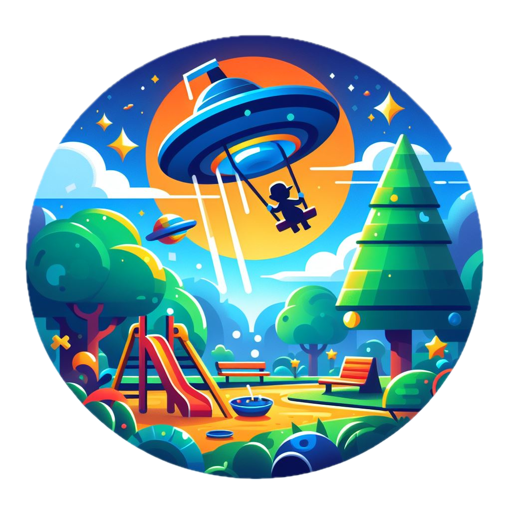

# MyPlayground

**MyPlayground** is an extension that puts small games in the side bar. Scores stay on this machine. Snake is the first game.

|Repository|GitHub|Visual Studio Marketplace|
|---|---|---|
|| ||
|| ||
||| |
||||

|Status|
|---|
|   |

## Feature

Open the **My Playground** icon in the activity bar. **Scores** lists the best result of every game. Each game links to that list. A result stays on this machine.

### Snake

The board starts on its own.

Click the board, then steer with the arrow keys or WASD. The buttons under the board work without keyboard focus. The restart button sits in the view title.

The snake speeds up every four snacks. Hitting a wall or itself ends the run. Filling the board clears it. The best score is stored in the extension global state.

## Installation

To install this extension, you have **three** options:

### 1. Search Extension in Marketplace

Search and install online extension via VSC extensions menu.

`Code` -> `Preferences` -> `Extensions` simply search for `MyPlayground` to install.

### 2. Install via vsix file

Download latest [vsix file](https://github.com/dennykorsukewitz/VSCode-MyPlayground/releases) and install via extensions menu.

`Code` -> `Preferences` -> `Extensions` -> `Views and More Action` -> `Install from VSIX`.

### 3. Source code

Download archive with the latest [release](https://github.com/dennykorsukewitz/VSCode-MyPlayground/releases) and unpack it to VisualStudioCode extensions folder
`$HOME/.vscode/extensions/`.

---

## Download

For download see [VSCode-MyPlayground](https://github.com/dennykorsukewitz/VSCode-MyPlayground/releases)

---

Enjoy!

Your [Denny Korsukéwitz](https://github.com/dennykorsukewitz) 🚀
